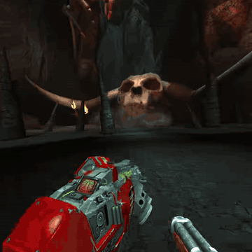
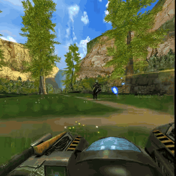

# Serious Sam 2 VR

Serious Sam 2 VR is an OpenXR mod for the Steam version of Serious Sam 2
<p>
  
  
</p>

## Features

- OpenXR head and controller tracking with stereo rendering of the original game
- Tracked weapons, dual wielding, and a weapon wheel on each hand
- Throwable grenades, grabbing and throwing objects, and arm-stroke swimming
- Sniper scopes you look through; the scoped shot is live while your eye is behind the scope
- Vehicles and turrets with a virtual steering wheel and grabbable handles
- Menus, cutscenes, and movies on a floating screen; wrist or head HUD
- Co-op with VR and desktop players together, voice chat, and level cutscenes for everyone
- Windows and Linux (Proton)

## Installation

Download the installer for your system from
[Releases](https://github.com/ObeseCatLord/Serious-Sam-2-VR/releases/latest) and run it:

- **Windows:** `ss2vr-installer-windows-x86_64.exe`
- **Linux:** `ss2vr-installer-linux-x86_64` (`chmod +x` it first)

It finds Serious Sam 2 through Steam and installs the mod. Run it again to update
(your settings are kept) or to uninstall.

Run the game **windowed** with MSAA off, and start your OpenXR runtime (SteamVR,
Monado, WiVRn...) before the game.

On Linux, set the game's Steam launch options to:

```
WINEDLLOVERRIDES="d3d9=n,b" PRESSURE_VESSEL_IMPORT_OPENXR_1_RUNTIMES=1 %command%
```

## Co-op

Every player and the server need the same mod version. Desktop players can join VR
players. Run the dedicated server with `+mod SS2VR`. Turn on **USE COMBO WEAPONS**
in the co-op settings for independent dual weapons.

## Settings

In VR, open **VR options** from the weapon wheel's options bubble or the button under
the game's menus. Settings are also in
`Bin/SS2VR/SS2VR.ini` in the game folder.

### VR controllers (Valve Index)

| Input | Action |
| --- | --- |
| Left stick | Move (relative to where you look) |
| Right stick left/right | Smooth or snap turn |
| Trigger | Fire that hand's weapon |
| Trackpad press (either hand) | Weapon wheel for that hand |
| Right A | Use, enter/leave vehicles and turrets |
| Right B | Jump |
| Left B | Pause menu |
| Left A | Reload |
| Left stick click | Sprint |
| Right stick click | Grenade |
| Grip | Grab and throw objects |
| Look through a sniper scope | Zoom (scoped shot) |
| Both sticks clicked | Recenter |

Other controllers:

| Profile | Weapon wheel (left / right) | Use | Jump | Menu | Reload |
| --- | --- | --- | --- | --- | --- |
| Oculus Touch | Y / B | A | Grip | Left menu | X |
| HTC Vive | Trackpad click | Right menu | Grip | Left menu | — |
| Windows Mixed Reality | Trackpad click | Left menu | Grip | Right menu | — |
| Steam Frame | Left D-pad up / right B | Right A | Grip | Left view / right menu | Left D-pad down |

## License

GNU General Public License version 3 (GPL-3.0-only); see [LICENSE](LICENSE).
Third-party components are listed in [THIRD_PARTY.md](THIRD_PARTY.md). Serious Sam 2
and its assets belong to their rights holders and are not included.
